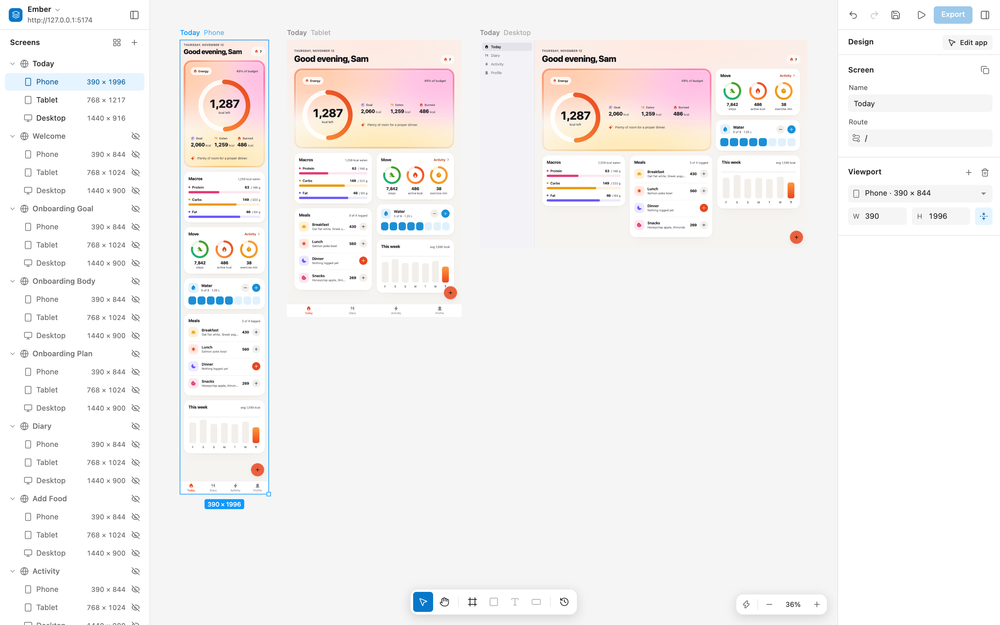
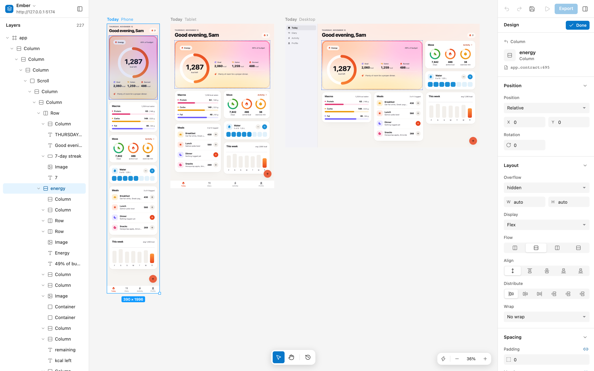

# Exact Design

**A visual editor for Exact apps.**

Compare phone, tablet, and desktop layouts on one canvas. Edit layout and appearance in live previews, then review your draft before applying it to source.

[Run locally](#run-locally) · [Try the demo](#try-the-demo) · [Use the studio](docs/use-the-studio.md) · [Changelog](CHANGELOG.md)



Blank screens support editable layers and Contract export.

## Run locally

Install Bun 1.4.2 and Rust through rustup, then run:

```sh
bun run setup
bun run dev
```

Open [the studio](http://127.0.0.1:5173). Setup installs the pinned Exact SDK in `.exact-sdk`. The editor also uses port 5175 for its local preview helper.

## Try the demo

In a second terminal, start Ember:

```sh
bun run demo
```

Open the setup link printed in the terminal to add Ember's screens at phone, tablet, and desktop sizes.

Select a viewport, click **Edit app**, and change a property. Click **Review** to inspect the draft, then **Apply changes** to write it to source.



## Documentation

| Guide | What you'll find |
| --- | --- |
| [Use the studio](docs/use-the-studio.md) | Connect your app, arrange screens, and edit drafts |
| [Development](docs/development.md) | Commands, test requirements, and source layout |
| [Studio design system](docs/studio-design-system.md) | Shared controls, tokens, icons, and interactions |
| [Ember](examples/ember/README.md) | The demo app and its screens |
| [Contributing](CONTRIBUTING.md) | Report issues, run checks, and open pull requests |

[Changelog](CHANGELOG.md) · [Security policy](SECURITY.md)

## Status

Browser previews run the web build, including at iPhone and iPad sizes. Native iOS and macOS previews are not qualified. Figma file import, structural source editing, and rollback of applied drafts are not implemented. Enlarged system text still needs accessibility work.

## License

Exact Design is released under the [MIT License](LICENSE). Vendored icons keep their own licenses: [Lucide](studio/assets/lucide/LICENSE) in the studio and [Phosphor](examples/ember/assets/icons/LICENSE) in Ember.
